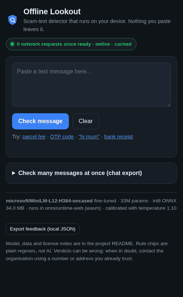
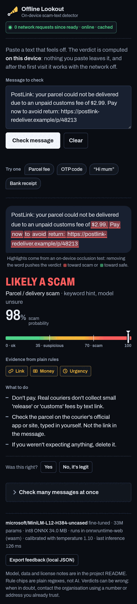
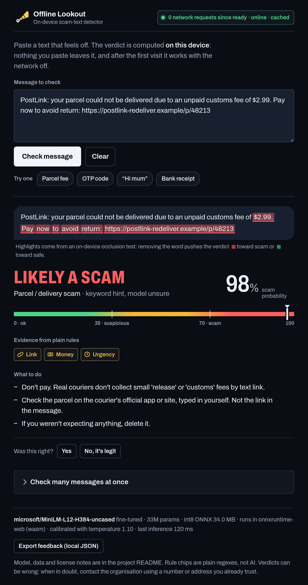

This project was submitted to the ryze.ai hackathon by Mike Sewell.

<p></p>

# Offline Lookout

**An on-device scam-text detector.** Paste a suspicious SMS or chat message and
get a verdict (green / yellow / red with a calibrated probability), the type of
scam, the words that drove the decision, and plain-language advice on what to
do. Everything runs inside your browser. Nothing you paste ever leaves your
device, and after the first visit the app works with the network switched off.

This is a submission to the **Ryze AI Hack: Small Models** (https://open-ryze.web.app/).



<p>
  
  
</p>

## The model

| | |
|---|---|
| Base model | [`microsoft/MiniLM-L12-H384-uncased`](https://huggingface.co/microsoft/MiniLM-L12-H384-uncased) (MIT) |
| Parameters | **33.2 million** (12 layers, hidden size 384) |
| Heads | binary scam / not-scam, plus a 6-way scam-type head (delivery, banking, prize, impersonation, government, account) |
| Export | ONNX opset 17 via PyTorch, dynamic **int8** (per-channel) with Hugging Face Optimum: **~34 MB** |
| Runtime | [onnxruntime-web](https://onnxruntime.ai/) WebAssembly, single thread, in the browser. A built-in BERT WordPiece tokenizer (parity-tested against the Hugging Face tokenizer) feeds it. |
| Calibration | temperature scaling fit on the validation split; the percentage shown is the calibrated probability |
| Remote inference | **none**. No OpenAI, no Hugging Face Inference API, no server of ours. The only network traffic is the first download of the static app and model files, which the service worker then caches. The header badge counts network requests after the model is ready; it stays at 0. |

Fine-tuning is done on CPU in about 25 minutes with a fixed seed (42). See
[`MODEL_CARD.md`](MODEL_CARD.md) for the full card.

<!-- EVAL:START -->
## Evaluation (headline)

Seed 42, CPU. `test` = held-out 10% of the de-duplicated UCI + Mendeley data (586 messages). `modern holdout` = 300 hand-written 2026-style messages never used in training (180 scams, 120 hard negatives such as OTP codes, delivery notices and bank receipts). Full table: [`train/eval/EVAL.md`](train/eval/EVAL.md).

| Model | Split | P | R | F1 | ROC-AUC | FPR |
|---|---|---|---|---|---|---|
| TF-IDF + LogReg baseline | test | 97.8% | 95.6% | 0.967 | 0.998 | 0.4% |
| TF-IDF + LogReg baseline | modern holdout | 91.5% | 90.0% | 0.908 | 0.945 | 12.5% |
| MiniLM, legacy data only (control) | test | 95.7% | 97.8% | 0.967 | 0.996 | 0.8% |
| MiniLM, legacy data only (control) | modern holdout | 70.9% | 86.7% | 0.780 | 0.696 | 53.3% |
| **MiniLM int8 ONNX (shipped)** | test | 95.7% | 98.9% | 0.973 | 0.996 | 0.8% |
| **MiniLM int8 ONNX (shipped)** | modern holdout | 96.8% | 99.4% | 0.981 | 0.986 | 5.0% |

Hard-negative FPR on the modern holdout (shipped model): bank 0/15, delivery 1/26, otp 0/25, personal 3/20, reminder 0/15, service 2/20.
Scam-type head accuracy on modern holdout scams: 66.1% (6-way).
Calibration ECE on modern holdout: 0.016. Confusion (tn/fp/fn/tp): 114/6/1/179.
Latency (onnxruntime CPU, intra_op_threads=1, single message, no batching): p50 7.0 ms, p95 8.7 ms. Size: int8 ONNX 34.0 MB (fp32 133.1 MB, not shipped).
<!-- EVAL:END -->

## How it works

1. **Classifier.** MiniLM encodes the message; the `[CLS]` vector feeds two
   linear heads. The binary head gives P(scam); the type head gives a
   distribution over six scam families, trained with weak keyword labels on
   the legacy spam data and real labels on the hand-written modern data. When
   the type head is unsure (below 60%), a keyword hint picks the family and the
   card says so.
2. **Explainability (on device).** Multi-scale occlusion: single words, 3-word
   spans and thirds of the message are each removed, all variants are scored in
   one batched ONNX run, and the change in scam log-odds is attributed to the
   words removed (strongest effect wins, normalised by span length). Red
   highlights push toward "scam", green toward "safe". No gradients, no server.
3. **Rule chips (no AI).** Plain regular expressions flag a link, a
   short link, a lookalike domain (digits in the name, brand word in a
   subdomain, odd TLD, raw IP), a phone number, money, urgency, and requests
   for credentials. They are evidence shown next to the verdict, not inputs
   to the model.
4. **What to do.** A static tip set per scam type.
5. **Offline proof.** A Workbox service worker precaches the app, the int8
   model and the wasm runtime. The badge in the header counts resources that
   hit the network and every `fetch`/XHR after the model is ready.
6. **Extras.** Android Web Share Target (share a text from Messages straight
   into the app), batch check of a pasted chat export with CSV download, and a
   local-only feedback log you can export as JSON. Nothing is uploaded.

## Run it locally

Prerequisites: Node 20+ for the app; Python 3.11 for training (optional, the
trained model is committed).

```bash
# App (serves the committed model)
cd web
npm ci --ignore-scripts
VITE_BASE=/ npm run dev            # http://localhost:5173
VITE_BASE=/ npm run build && VITE_BASE=/ npm run preview   # production build + service worker

# Training pipeline (CPU, ~1 hour for both runs, fixed seed)
python3.11 -m venv .venv && .venv/bin/pip install -r train/requirements.txt
bash train/run_all.sh
```

`train/run_all.sh` downloads and checksums the datasets, cleans and de-duplicates
them, trains the TF-IDF baseline, fine-tunes MiniLM (shipped config and a
legacy-only control), exports and quantises to ONNX, evaluates everything,
checks tokenizer parity and copies the model into `web/public/model/`.

The GitHub Pages workflow in `.github/workflows/pages.yml` builds `web/` with
the base path `/<repo>/` and deploys it on every push to `main`.

## Repository layout

```
train/            data pipeline, fine-tuning, export, evaluation (Python)
train/templates/  hand-written modern scams + hard negatives (fictional)
train/eval/       metrics JSON and the rendered EVAL.md table
web/              Vite + TypeScript PWA (src/model.ts = inference, explain.ts = occlusion,
                  rules.ts = chips, tokenizer.ts = WordPiece, netwatch.ts = badge)
web/public/model/ model_int8.onnx, vocab.txt, model_meta.json
MODEL_CARD.md     model card
DATA_LICENSES.md  every dataset and model license, verified at source
DEMO_SCRIPT.md    shot list for the 2-minute demo video
```

## Data and licenses

- Code: MIT (see `LICENSE`).
- Base model `microsoft/MiniLM-L12-H384-uncased`: MIT.
- [SMS Spam Collection](https://archive.ics.uci.edu/dataset/228/sms+spam+collection)
  (Almeida & Gómez Hidalgo, UCI): CC BY 4.0.
- [SMS Phishing Dataset for Machine Learning and Pattern Recognition](https://data.mendeley.com/datasets/f45bkkt8pr/1)
  (Mishra & Soni, Mendeley Data): CC BY 4.0.
- 527 hand-written modern messages in `train/templates/`: MIT, written for this
  project; all phone numbers, domains and brands are fictional.

Full details, citations and the changes made to each dataset are in
[`DATA_LICENSES.md`](DATA_LICENSES.md).

## Limitations

- English only. A multilingual model is the obvious next step.
- Trained mostly on 2011-era SMS; the modern hand-written sets are small. The
  eval table shows exactly how far the model generalises and where it fails.
- Verdicts can be wrong in both directions. The app says so, and the advice is
  always to verify through a channel you already trust.
